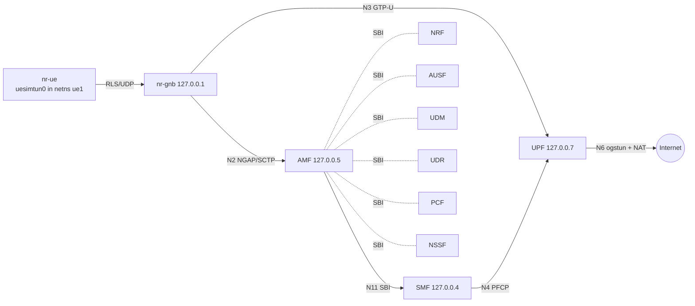

# Module 1. 5G SA core and first registration

**Goal:** Open5GS 5GC (AMF, SMF, UPF, NRF, AUSF, UDM, UDR, PCF, NSSF, BSF) with UERANSIM gNB and UE.
Register the UE, establish a PDU session, pass user-plane traffic.

**Status:** registration, PDU session and user plane work (UE pings the UPF and the internet).
Call flows for Registration, PDU Session Establishment and Deregistration are in [callflow.md](callflow.md).
Next: failure scenarios.

## Setup

| Item | Value |
|------|-------|
| Host | Ubuntu Server 26.04 VM, 4 vCPU, 4 GB RAM (see [docs/setup-hyperv.md](../docs/setup-hyperv.md)) |
| Core | Open5GS 2.8.0 (PPA `open5gs/latest`), no WebUI |
| Database | MongoDB 7 in Docker, `127.0.0.1:27017` |
| RAN / UE | UERANSIM v3.3.0, built from source |
| PLMN | 250/99, TAC 1, S-NSSAI SST 1, DNN `internet` |
| UE | IMSI 250990000000001, test K/OPc from UERANSIM examples |
| UE pool | 10.45.0.0/16, UPF `ogstun` 10.45.0.1 |

All NFs run on loopback with the Open5GS default addresses (AMF NGAP 127.0.0.5:38412, UPF GTP-U 127.0.0.7:2152).



## Install

```bash
sudo add-apt-repository -y ppa:open5gs/latest
sudo apt install -y open5gs docker.io
sudo docker run -d --name mongo --restart unless-stopped -p 127.0.0.1:27017:27017 mongo:7

sudo apt install -y make gcc g++ cmake libsctp-dev lksctp-tools iproute2 git
git clone https://github.com/aligungr/UERANSIM ~/UERANSIM && make -C ~/UERANSIM
```

## Run

```bash
cd mobile-core-lab/01-5gsa-core/scripts
sudo ./host-setup.sh                 # after every reboot
sudo ./set-plmn.sh 250 99            # once
./add-subscriber.sh 250990000000001  # once

# terminal 1: capture
sudo tcpdump -i any -w ~/m1-registration.pcap
# terminal 2: gNB
cd ~/UERANSIM && build/nr-gnb -c config/lab-gnb.yaml
# terminal 3: UE
cd ~/UERANSIM && sudo build/nr-ue -c config/lab-ue.yaml
# terminal 4: move the UE into its own namespace, then test
sudo ./ue-netns.sh
sudo ip netns exec ue1 ping -c4 10.45.0.1
sudo ip netns exec ue1 ping -c4 8.8.8.8
```

## Result

```
[nas] Initial Registration is successful
[nas] PDU Session establishment is successful PSI[1]
[app] Connection setup for PDU session[1] is successful, TUN interface[uesimtun0, 10.45.0.3] is up.
```

From netns `ue1`: 4/4 replies from 10.45.0.1 (~2.5 ms) and 4/4 from 8.8.8.8 (~10 ms).

Observed in the first registration: the first Authentication Request was rejected by the UE
with a synchronisation failure (SQN out of range), the AUSF/UDM resynchronised and the second
challenge passed. Security mode selected NIA2 integrity and NEA0 ciphering, so NAS is readable in the capture.

## Single-host issues and fixes

| Symptom | Cause | Fix |
|---------|-------|-----|
| `TUN configuration failure [Could not open '/etc/iproute2/rt_tables']` | Ubuntu 26.04 moved the file to `/usr/share/iproute2` | copy it to `/etc/iproute2` (`host-setup.sh`) |
| GTP-U reaches `ogstun`, nothing leaves `eth0` | Docker sets `iptables -P FORWARD DROP` | accept `ogstun` in `DOCKER-USER` (`host-setup.sh`) |
| `ping -I uesimtun0 8.8.8.8` returns `Time to live exceeded` | UE and UPF share one routing table; UERANSIM's source rule for the UE address sends decapsulated packets back into `uesimtun0` | move `uesimtun0` to its own netns (`ue-netns.sh`) |

## Captures and analysis

- [`pcap/m1-registration.pcap`](pcap/m1-registration.pcap): N2 (NGAP), N1 NAS (NEA0, readable), N4 (PFCP), SBI (HTTP/2 via SCP)
- [`callflow.md`](callflow.md): Registration with 5G-AKA, PDU Session Establishment, UE-initiated Deregistration, frame by frame
- [`pcap/m1-n3-gtpu.pcap`](pcap/m1-n3-gtpu.pcap): N3 GTP-U with PDU Session container (QFI), UE ping to 8.8.8.8
- [`failures.md`](failures.md): break/fix scenarios with captures (F1 done)
- to add: Service Request
- `failures.md`: wrong K/OPc, foreign PLMN, S-NSSAI mismatch, wrong DNN, UPF down, NRF down
