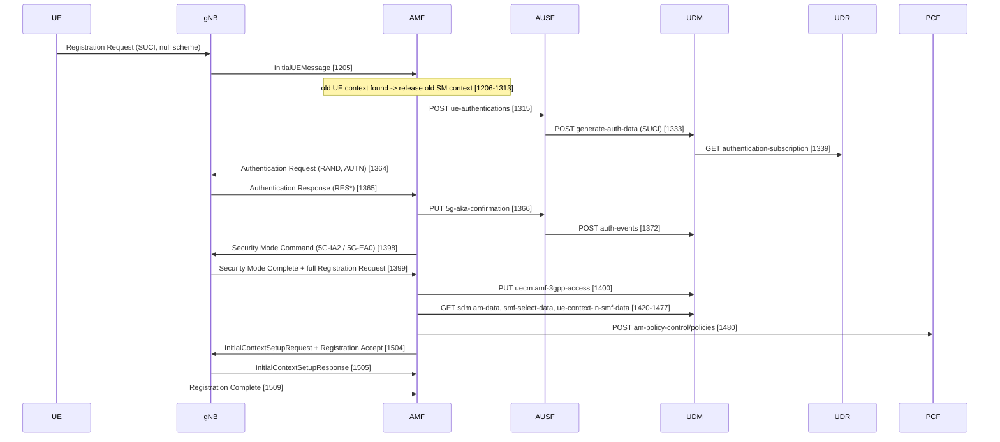
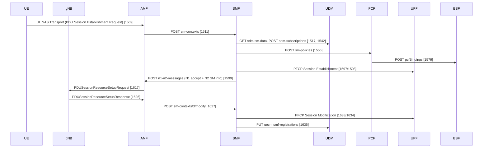

# Module 1 call flows

Capture: [`pcap/m1-registration.pcap`](pcap/m1-registration.pcap) (loopback only, 4783 frames, ~5 min).
Filter used: `sctp or udp port 2152 or udp port 8805 or tcp port 7777`.

Open in Wireshark with:
- Decode As: SCTP port 38412 → NGAP, TCP port 7777 → HTTP2
- Preferences → NAS-5GS → "Try to detect and decode 5G-EA0 ciphered messages" (NEA0 is negotiated, so NAS after Security Mode is readable)

Frame numbers below refer to this file.

## Addresses (Open5GS defaults)

| IP | Node | | IP | Node |
|----|------|-|----|------|
| 127.0.0.1 | gNB (UERANSIM), also NF client side | | 127.0.0.11 | AUSF |
| 127.0.0.5 | AMF (NGAP :38412, SBI :7777) | | 127.0.0.12 | UDM |
| 127.0.0.4 | SMF (SBI, PFCP :8805) | | 127.0.0.13 | PCF |
| 127.0.0.7 | UPF (PFCP :8805, GTP-U :2152) | | 127.0.0.15 | BSF |
| 127.0.0.10 | NRF | | 127.0.0.20 | UDR |
| 127.0.0.200 | SCP | | | |

All SBI requests go through the SCP (indirect communication): every request appears twice,
NF → SCP (127.0.0.200) and SCP → target NF. The EPC part of the package (MME/HSS/PCRF) is also
running, which explains the Diameter heartbeats (DWR/DWA) in the file.

## 1. Initial Registration with 5G-AKA

TS 23.502 §4.2.2.2.2, TS 33.501 §6.1.3.2, NAS TS 24.501, NGAP TS 38.413.



| Frame | Interface | Message | What to look at |
|-------|-----------|---------|-----------------|
| 1205 | N2/N1 | InitialUEMessage, Registration Request | registration type initial; identity SUCI, SUPI format IMSI, MCC 250 MNC 99, protection scheme **null**, MSIN 0000000001; plain NAS |
| 1206–1313 | N11, N4, SBI | release of SM context 2 | UE was restarted without deregistering; AMF cleans the old PDU session: SMF release, PFCP Session Deletion, PCF policy delete, BSF binding delete, UDM/UDR cleanup |
| 1315 | SBI | AMF → AUSF `POST /nausf-auth/v1/ue-authentications` | start of 5G-AKA |
| 1333 | SBI | AUSF → UDM `POST /nudm-ueau/v1/suci-0-250-99-0000-0-0-0000000001/.../generate-auth-data` | UDM (SIDF) de-conceals SUCI → SUPI; with the null scheme the MSIN is in clear |
| 1339 | SBI | UDM → UDR `GET .../authentication-subscription` | K, OPc, SQN read from the subscriber record |
| 1364 | N1 | Authentication Request | RAND, AUTN (contains SQN ⊕ AK and MAC), ngKSI |
| 1365 | N1 | Authentication Response | RES*; AMF compares HRES* with HXRES*, AUSF compares RES* with XRES* |
| 1366–1395 | SBI | `PUT .../5g-aka-confirmation` → `200`; `POST /nudm-ueau/.../auth-events` → `201` | authentication confirmed, Kseaf handed to AMF |
| 1398 | N1 | Security Mode Command | **128-5G-IA2** integrity, **5G-EA0** ciphering, IMEISV requested; integrity protected with new context |
| 1399 | N1 | Security Mode Complete | carries IMEISV and the full Registration Request in the NAS message container |
| 1400–1417 | SBI | `PUT /nudm-uecm/v1/imsi-.../registrations/amf-3gpp-access` | AMF registers itself as serving AMF in UDM (and UDR) |
| 1420–1477 | SBI | `GET /nudm-sdm/v2/imsi-.../am-data`, `smf-select-data`, `ue-context-in-smf-data` | access and mobility subscription for PLMN 250/99 |
| 1480–1501 | SBI | `POST /npcf-am-policy-control/v1/policies` → `201` | AM policy association |
| 1504 | N2/N1 | InitialContextSetupRequest + Registration Accept | KgNB (SecurityKey IE) to gNB; 5G-GUTI: AMF Region 2, AMF Set 1, Pointer 0, 5G-TMSI 0xc0000189; Allowed NSSAI SST 1; TAI 250/99/1 |
| 1505 | N2 | InitialContextSetupResponse | AS security can start |
| 1509 | N1 | Registration Complete (+ UL NAS Transport with PDU Session Establishment Request) | UE acknowledges the GUTI |
| 1510 | N1 | Configuration Update Command | network name / time info |

Note on SQN resynchronisation: in the first run of the day (not in this file) the UE rejected the
first challenge with *Authentication Failure, Synch failure* because SQN in the database (0) was out of
the UE's window. The UE sends AUTS, UDM resynchronises SQN and a second Authentication Request passes.
UERANSIM log:

```
Received SQN [000000000000]
Sending Authentication Failure due to SQN out of range
Authentication Request received
Received SQN [000000000021]
Security Mode Command received
```

## 2. PDU Session Establishment

TS 23.502 §4.3.2.2.1, PFCP TS 29.244.



| Frame | Interface | Message | What to look at |
|-------|-----------|---------|-----------------|
| 1509 | N1 | UL NAS Transport, PDU Session Establishment Request | PSI 1, request type initial, DNN `internet`, S-NSSAI SST 1 |
| 1511 | N11 | `POST /nsmf-pdusession/v1/sm-contexts` → `201` [1563] | AMF selects SMF, creates SM context 3 |
| 1517 | SBI | `GET /nudm-sdm/v2/imsi-.../sm-data?single-nssai={sst:1}&dnn=internet` | session management subscription |
| 1556 | N7 | `POST /npcf-smpolicycontrol/v1/sm-policies` → `201` | SM policy (QoS, AMBR) |
| 1579 | SBI | PCF → BSF `POST /nbsf-management/v1/pcfBindings` | binding of the session to this PCF |
| 1597/1598 | N4 | PFCP Session Establishment Request/Response | SMF installs PDRs/FARs on the UPF; uplink F-TEID allocated by the UPF |
| 1599 | N11 | SMF → AMF `POST /namf-comm/v1/ue-contexts/imsi-.../n1-n2-messages` | N1 PDU Session Establishment Accept + N2 PDU Session Resource Setup Request Transfer |
| 1617 | N2/N1 | PDUSessionResourceSetupRequest + DL NAS Transport, PDU Session Establishment Accept | UPF N3 address 127.0.0.7, UL TEID 0x0000425d; QoS flow 5QI 9; Session-AMBR 1 Gbps UL/DL; UE IP **10.45.0.4**; DNS 8.8.8.8 / 8.8.4.4; SSC mode 1 |
| 1626 | N2 | PDUSessionResourceSetupResponse | gNB N3 address 127.0.0.1, DL TEID 0x00000003 |
| 1627–1634 | N11, N4 | `POST sm-contexts/3/modify` → PFCP Session Modification | SMF gives the UPF the gNB DL F-TEID; downlink path complete |
| 1635–1652 | SBI | `PUT /nudm-uecm/v1/imsi-.../registrations/smf-registrations/1` | SMF registers itself in UDM for PSI 1 |

## 3. UE-initiated Deregistration

TS 23.502 §4.2.2.3.2. Triggered with `nr-cli imsi-250990000000001 -e "deregister normal"`.

| Frame | Interface | Message | What to look at |
|-------|-----------|---------|-----------------|
| 2375 | N1 | Deregistration Request (UE originating) | switch off: normal de-registration, access type 3GPP |
| 2379–2383 | N11, N4 | `POST sm-contexts/3/release`, PFCP Session Deletion | PDU session torn down on SMF and UPF |
| 2385–2418 | SBI | PCF sm-policy delete, BSF binding delete, UDM sdm-subscription delete, smf-registration delete | session-level cleanup |
| 2441–2482 | SBI | `PATCH .../amf-3gpp-access` (purge flag), AUSF confirmation delete, UDM auth-events, AM policy delete | AMF-level cleanup |
| 2487 | N1 | Deregistration Accept (UE originating) | |
| 2488/2490 | N2 | UEContextReleaseCommand / Complete | N2 signalling connection released |
| 2500 | N2/N1 | InitialUEMessage, Registration Request | UERANSIM registers again after a normal (non switch-off) deregistration |

## 4. User plane on N3 (GTP-U)

Capture: [`pcap/m1-n3-gtpu.pcap`](pcap/m1-n3-gtpu.pcap), filter `udp port 2152`, 5 pings from the UE
(netns `ue1`, UE IP 10.45.0.5 for this session) to 8.8.8.8. TS 29.281 (GTP-U), TS 38.415 (PDU Session container).

| Frames | Direction | Outer IP / TEID | Extension header | Inner packet |
|--------|-----------|-----------------|------------------|--------------|
| 1, 3, 5, 7, 9 | UL gNB → UPF | 127.0.0.1 → 127.0.0.7, TEID 0x0000ef73 (allocated by UPF) | PDU Session container, UL PDU SESSION INFORMATION, QFI 1 | 10.45.0.5 → 8.8.8.8 echo request |
| 2, 4, 6, 8, 10 | DL UPF → gNB | 127.0.0.7 → 127.0.0.1, TEID 0x00000004 (allocated by gNB) | PDU Session container, DL PDU SESSION INFORMATION, QFI 1 | 8.8.8.8 → 10.45.0.5 echo reply |

- T-PDU (message type 0xFF), UDP 2152 on both sides.
- Each direction uses the TEID allocated by the receiver: UPF gives the UL F-TEID in PFCP Session
  Establishment Response and N2 SM info; gNB gives the DL F-TEID in PDU Session Resource Setup Response,
  which the SMF installs on the UPF with PFCP Session Modification.
- QFI 1 is the default QoS flow (5QI 9) created at PDU session establishment.
- RTT ~8 ms, all 5 replies received.

## 5. Release to CM-IDLE and UE-triggered Service Request

Capture: [`pcap/m1-service-request.pcap`](pcap/m1-service-request.pcap) (40 frames: GTP-U, NGAP, N4 and the SMF
calls; NRF heartbeats removed). UE IP 10.45.0.19, 5G-TMSI 0xc0000075.

How it was triggered: the PDU session was up and pinging, then the gNB released the UE from the UERANSIM CLI
(`nr-cli UERANSIM-gnb-250-99-1 -e "ue-release 5"`), then the UE sent uplink data again.

| Frame | Time | Message | Note |
|-------|------|---------|------|
| 1–6 | 22:18:04–06 | GTP-U, ping 8.8.8.8 | UL TEID 0x0000f68a (UPF), DL TEID 0x00000002 (gNB) |
| 7 | 22:20:05.588 | NGAP UEContextReleaseRequest | from the gNB, cause radioNetwork unspecified; lists PDU session 1 |
| 8–9 | 05.588 | AMF → SMF `POST sm-contexts/18/modify` | `upCnxState: DEACTIVATED`, with `ngApCause` and UE location |
| 10–11 | 05.590 | PFCP Session Modification, Update FAR 1: **Apply Action BUFF + NOCP** | UPF now buffers downlink and notifies the SMF instead of sending it to the gNB |
| 12–13 | 05.590 | SMF → AMF `200 OK` | |
| 14–15 | 05.591 | UEContextReleaseCommand / Complete | UE goes to CM-IDLE, stays RM-REGISTERED |
| 16 | 22:20:14.105 | InitialUEMessage, **Service Request** | Service type Data, 5G-S-TMSI (AMF Set 1, 5G-TMSI 0xc0000075), ngKSI 3; Uplink data status PSI 1 pending; PDU session status PSI 1 active. The full message also travels in the NAS message container |
| 17–22 | 14.110–14.111 | AMF → SMF `sm-contexts/18/modify` `upCnxState: ACTIVATING` → `200` with N2 SM info `PDU_RES_SETUP_REQ` | SMF hands back the UL tunnel info for the gNB |
| 23 | 14.112 | InitialContextSetupRequest + **Service Accept** | PDUSessionResourceSetupItemCxtReq: UPF 127.0.0.7, UL TEID 0x0000f68a, QFI 1 |
| 24 | 14.114 | InitialContextSetupResponse | new gNB DL TEID **0x00000003** |
| 25–26 | 14.114–14.118 | AMF → SMF `sm-contexts/18/modify` with `PDU_RES_SETUP_RSP` | |
| 27–28 | 14.118 | PFCP Session Modification, Update FAR 1: **Apply Action FORW**, outer header TEID 0x00000003 | downlink forwarding back on, to the new gNB tunnel |
| 29–30 | 14.119 | `200 OK` | |
| 31–40 | 22:20:20–24 | GTP-U, ping 8.8.8.8, 5/5 replies | same UL TEID 0x0000f68a, new DL TEID 0x00000003 |

Notes:
- No authentication and no Security Mode Command: the AMF reuses the existing NAS security context (ngKSI 3).
  Service Request to Service Accept took 7 ms.
- The UE keeps its IP address and the UPF keeps its UL TEID. Only the gNB side of N3 is new (DL TEID 2 → 3),
  because the gNB dropped the UE context on release.
- While the UE was idle, the UPF had the downlink FAR on BUFF + NOCP. Downlink data at that point would have
  made the SMF ask the AMF to page the UE (network-triggered Service Request). That path was not tested here.
- The UE log shows `Service request required due to [IDLE-UPLINK-DATA-PENDING]` at 22:20:14.102, but the ping in
  this capture starts at 22:20:20.2. The packet that set "uplink data pending" at 22:20:14 is not on N3 (the UE
  was idle) and was not identified. It may be some other packet leaving the `ue1` namespace.

## Capture note (registration capture)

Two tcpdump processes briefly wrote to the same file; ~79 KB of interleaved records were dropped
during repair and the remaining frames were re-sorted by time. Signalling for registration, PDU session and deregistration (sections 1–3) is complete.
