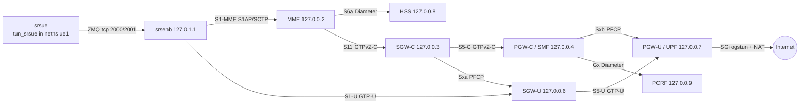

# Module 2. LTE / EPC and Diameter

**Goal:** Open5GS EPC (MME, HSS, PCRF, SGW-C/U, PGW-C/U) with srsRAN 4G eNB and UE over ZeroMQ.
Attach the UE, pass user-plane traffic, go to idle and back, detach. Read S1AP, NAS-EPS, Diameter (S6a, Gx),
GTPv2-C (S11, S5) and PFCP (Sxa/Sxb) in one capture.

**Status:** attach, user plane (UE pings 8.8.8.8), idle → Service Request and detach work.
Call flows are in [callflow.md](callflow.md). Found and worked around an srsUE/Open5GS interop issue
(UE could not leave idle), see [failures.md](failures.md#f1-tai-list-type-2-ue-cannot-leave-idle).

## Setup

| Item | Value |
|------|-------|
| Host | same VM as Module 1 (Ubuntu Server 26.04, 4 vCPU, 4 GB) |
| Core | Open5GS 2.8.0 EPC part of the same package (MME, HSS, PCRF, SGW-C, SGW-U; SMF/UPF act as PGW-C/PGW-U) |
| RAN / UE | srsRAN 4G (`srsran/srsRAN_4G` master), eNB and UE linked by ZeroMQ, no RF hardware |
| PLMN | 250/99, TAC 1, APN `internet` |
| UE | IMSI 250990000000001, same test K/OPc as Module 1 (HSS reads the same MongoDB) |
| Radio | FDD band 7 (DL 2680 MHz / UL 2560 MHz), 50 PRB, PCI 1, virtual only |



## Build srsRAN 4G

```bash
sudo apt install -y build-essential cmake libfftw3-dev libmbedtls-dev libboost-program-options-dev \
  libconfig++-dev libsctp-dev libzmq3-dev git
git clone https://github.com/srsran/srsRAN_4G ~/srsRAN_4G
mkdir ~/srsRAN_4G/build && cd ~/srsRAN_4G/build
cmake -DENABLE_WERROR=OFF ../     # GCC on 26.04 warns in a unit test; -Werror stops the build
make -j2 && sudo make install && sudo ldconfig
srsran_install_configs.sh user    # example configs to ~/.config/srsran
```

## Configure

```bash
./scripts/srsran-config.sh        # PLMN, MME address, TAC, USIM keys in ~/.config/srsran
```

On the Open5GS side the MME needs a TAC range, not a single TAC (see F1):

```yaml
# /etc/open5gs/mme.yaml, mme.tai
      tac: [1-2]
```

## Run

```bash
# terminal 1: capture (skip the ZMQ IQ sample ports, they are hundreds of MB per minute)
sudo tcpdump -i lo -w ~/m2-reference.pcap 'not port 2000 and not port 2001'
# terminal 2: eNB
cd ~/.config/srsran && sudo srsenb ./enb.conf --rf.device_name=zmq \
  --rf.device_args="fail_on_disconnect=true,tx_port=tcp://*:2000,rx_port=tcp://localhost:2001,id=enb,base_srate=23.04e6"
# terminal 3: UE
sudo ip netns add ue1
cd ~/.config/srsran && sudo srsue ./ue.conf --rf.device_name=zmq \
  --rf.device_args="tx_port=tcp://*:2001,rx_port=tcp://localhost:2000,id=ue,base_srate=23.04e6" --gw.netns=ue1
# terminal 4: traffic
sudo ip netns exec ue1 ip route replace default dev tun_srsue
sudo ip netns exec ue1 ping -c4 8.8.8.8
```

Stop the UE first (Ctrl+C sends Detach Request, switch-off), then the eNB.

## Result

```
Found PLMN:  Id=25099, TAC=1
RRC Connected
Network attach successful. IP: 10.45.0.27
Received RRC Connection Release (releaseCause: other)
RRC IDLE
Service Request with cause mo-Data.
Service Request successful.
```

Ping from netns `ue1` to 8.8.8.8: ~30–50 ms; the first packet after idle takes ~350 ms
(radio setup plus downlink buffering in the SGW-U, see callflow §4).

## Single-host issues and fixes

| Symptom | Cause | Fix |
|---------|-------|-----|
| `block_test.c: error: writing 1 byte into a region of size 0 [-Werror=stringop-overflow=]` | new GCC plus `ENABLE_WERROR=ON` default | `cmake -DENABLE_WERROR=OFF` |
| eNB never gets S1 Setup Response | default eNB points to srsEPC at 127.0.1.100, TAC 7 is in `rr.conf`, not `enb.conf` | `mme_addr = 127.0.0.2`, `tac = 0x0001` in `rr.conf` |
| UE re-attaches with a new IP after every idle period | srsUE does not store the GUTI from Open5GS (F1) | `tac: [1-2]` in `mme.yaml` |
| Default route in `ue1` disappears | `tun_srsue` is recreated on every attach | re-add the route after attach |

## Captures and analysis

- [`pcap/m2-reference.pcap`](pcap/m2-reference.pcap): S1 Setup, GUTI attach, idle, Service Request, ping, detach (2741 frames)
- [`pcap/f1-tai-list-type2.pcap`](pcap/f1-tai-list-type2.pcap): first IMSI attach with EPS-AKA and S6a, then the idle/re-attach loop of F1
- [`callflow.md`](callflow.md): Attach with EPS-AKA, S6a, Gx, GTPv2 session setup, idle and Service Request, detach
- [`failures.md`](failures.md): break/fix scenarios
