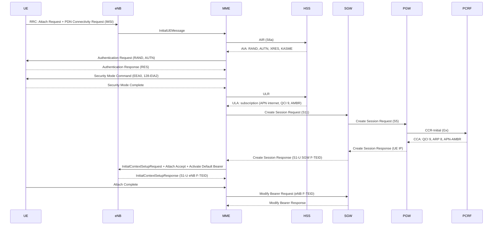

# Module 2 call flows

Two captures, loopback only, ZMQ sample ports (2000/2001) excluded:

| File | Contents | Used for |
|------|----------|----------|
| [`pcap/f1-tai-list-type2.pcap`](pcap/f1-tai-list-type2.pcap) | 9229 frames. First attach with IMSI, full EPS-AKA and S6a (frames 2022–2110), then the F1 loop | §1, §2 |
| [`pcap/m2-reference.pcap`](pcap/m2-reference.pcap) | 2741 frames, 212 s. S1 Setup, GUTI attach, idle, Service Request, ping, detach | §3–§5 |

Wireshark: S1AP (SCTP 36412), Diameter (3868), GTPv2 (2123), GTP-U (2152) and PFCP (8805) are decoded
by default. Enable Preferences → Protocols → NAS-EPS → "Try to detect and decode EEA0 ciphered messages"
(the MME negotiates EEA0/128-EIA2, so NAS after Security Mode is readable).
Useful filter: `s1ap || gtpv2 || pfcp || (diameter && !(diameter.cmd.code == 280))` (280 = Device-Watchdog).

## Addresses (Open5GS defaults)

| IP | Node | Interfaces |
|----|------|------------|
| 127.0.1.1 | eNB (srsenb) | S1-MME client, S1-U |
| 127.0.0.2 | MME `open5gs-mme0`, MMEGI 2, MMEC 1 | S1-MME :36412, S11, S6a |
| 127.0.0.3 | SGW-C | S11, S5-C, Sxa |
| 127.0.0.6 | SGW-U | Sxa, S1-U, S5-U |
| 127.0.0.4 | PGW-C (Open5GS SMF) | S5-C, Gx, Sxb |
| 127.0.0.7 | PGW-U (Open5GS UPF) | Sxb, S5-U, SGi (`ogstun` 10.45.0.1) |
| 127.0.0.8 | HSS | S6a |
| 127.0.0.9 | PCRF | Gx |

The 5GC NFs of Module 1 run as well (NRF, SCP, ...), so their heartbeats appear in the files.

## 1. Attach with EPS-AKA (IMSI attach)

TS 23.401 §5.3.2.1, TS 33.401 §6.1, NAS TS 24.301, S1AP TS 36.413, S6a TS 29.272, Gx TS 29.212, GTPv2 TS 29.274.
File `f1-tai-list-type2.pcap`.

| Frame | Time, s | Path | Message | Notes |
|------:|--------:|------|---------|-------|
| 2022 | 159.205 | eNB → MME | InitialUEMessage, Attach request, PDN connectivity request | EPS attach, identity **IMSI** 250990000000001, PDN type IPv4 |
| 2023 | 159.250 | MME → HSS | Diameter **AIR** (cmd 318, app S6a 16777251) | User-Name = IMSI, Visited-PLMN-Id 250/99 |
| 2051 | 159.481 | HSS → MME | **AIA**, Result-Code 2001 | E-UTRAN-Vector: RAND, XRES `02b8956010a3c981`, AUTN, KASME |
| 2052 | 159.499 | MME → UE | Authentication request | RAND and AUTN from the vector |
| 2054 | 159.544 | UE → MME | Authentication response | RES `02b8956010a3c981` = XRES, the MME accepts |
| 2055 | 159.544 | MME → UE | Security mode command | EEA0 (null ciphering), 128-EIA2 integrity, new EPS security context |
| 2056 | 159.570 | UE → MME | Security mode complete | |
| 2057 | 159.574 | MME → HSS | Diameter **ULR** (cmd 316) | RAT-Type EUTRAN, ULR-Flags 34 |
| 2065 | 159.587 | HSS → MME | **ULA**, Result-Code 2001 | Subscriber-Status SERVICE_GRANTED, APN `internet`, AMBR |
| 2066 | 159.606 | MME → SGW-C | GTPv2 Create Session Request (S11) | MME S11 F-TEID, PGW S5 address, EBI 5 |
| 2068–2069 | 159.666 | SGW-C ↔ SGW-U | PFCP Session Establishment (Sxa) | |
| 2070 | 159.706 | SGW-C → PGW-C | Create Session Request (S5) | |
| 2071 | 159.748 | PGW-C → PCRF | Diameter **CCR-Initial** (cmd 272, app Gx 16777238) | Framed-IP-Address 10.45.0.20, Called-Station-Id `internet` |
| 2079 | 159.809 | PCRF → PGW-C | **CCA** | QCI 9, Priority-Level 8, APN-AMBR 1 Gbps UL/DL |
| 2081–2082 | 159.852 | PGW-C ↔ PGW-U | PFCP Session Establishment (Sxb) | |
| 2083 | 159.942 | PGW-C → SGW-C | Create Session Response | PAA 10.45.0.20 |
| 2084–2085 | 159.959 | SGW-C ↔ SGW-U | PFCP Session Modification | S5-U toward PGW-U |
| 2086 | 159.976 | SGW-C → MME | Create Session Response | S1-U SGW F-TEID |
| 2087 | 159.998 | MME → eNB | InitialContextSetupRequest, Attach accept, Activate default EPS bearer context request | E-RAB 5 → SGW-U; GUTI 250/99/2/1/0xc00007f4; T3412 9 min; ESM: APN `internet`, QCI 9, 10.45.0.20 |
| 2105 | 160.305 | eNB → MME | InitialContextSetupResponse + Attach complete | eNB S1-U address and TEID |
| 2106 | 160.308 | MME → SGW-C | Modify Bearer Request | eNB F-TEID |
| 2110 | 160.311 | SGW-C → MME | Modify Bearer Response | downlink path complete |

Attach Request to Attach Complete: 1.10 s. Most of it is radio and UE processing on the
single VM; the core legs are 10–90 ms each.

**EPS-AKA vs 5G-AKA.** In EPS the HSS hands the MME the clear XRES and the MME compares RES itself.
In 5G the AMF/SEAF gets only HXRES* and the home AUSF makes the final check, so the home network
does not have to trust the serving network's comparison. K never leaves the HSS and the USIM in either case.

## 2. Gx: what the PCRF decides

CCR-I (2071) carries the UE IP and APN; CCA (2079) returns the default bearer QoS (QCI 9, ARP priority 8)
and APN-AMBR. The same pair with CC-Request-Type TERMINATION closes the session on detach (§5)
and before every forced re-attach in F1 (e.g. frames 3329/3335).

## 3. GTPv2: building the tunnels

File `m2-reference.pcap`, GUTI attach at t = 91 s (frames 1148–1194). The UE comes back with the GUTI
from the previous run (M-TMSI 0xc0000648); the MME still holds its security context, so there is no
authentication and no S6a in this attach.

Each end of a tunnel is an F-TEID (IP + TEID). The session setup is an exchange of F-TEIDs:

| Frame | Message | F-TEID | Value |
|------:|---------|--------|-------|
| 1149 | Create Session Request (MME → SGW-C) | S11 MME GTP-C | 127.0.0.2, 0x0000026a |
| 1165 | Create Session Response (SGW-C → MME) | S11 SGW GTP-C | 127.0.0.3, 0x000002f7 |
| | | S5/S8 PGW GTP-C | 127.0.0.4, 0x00000e5d |
| | | **S1-U SGW GTP-U** | **127.0.0.6, 0x0000fc30** |
| | | S5/S8 PGW GTP-U | 127.0.0.7, 0x0000b798 |
| 1166 | InitialContextSetupRequest (MME → eNB) | E-RAB 5 transport | 127.0.0.6, 0x0000fc30 |
| 1190 | Modify Bearer Request (MME → SGW-C) | **S1-U eNodeB GTP-U** | **127.0.1.1, 0x00000001** |

The eNB F-TEID only exists after the eNB has set up the radio bearer, so it reaches the SGW in a
separate Modify Bearer after InitialContextSetupResponse. From then on the user plane is
`eNB → SGW-U (TEID 0xfc30) → PGW-U (TEID 0xb798) → SGi`.

Attach Accept in this file carries a **type 1** TAI list (one PLMN, consecutive TACs), the result of the F1 workaround.

## 4. Idle and UE-triggered Service Request

TS 23.401 §5.3.5 (S1 release), §5.3.4.1 (UE-triggered Service Request).

| Frame | Time, s | Message | Notes |
|------:|--------:|---------|-------|
| 1660 | 130.752 | UEContextReleaseRequest, cause user-inactivity | eNB inactivity timer, ~40 s after attach |
| 1661/1664 | 130.752 | Release Access Bearers Request/Response (S11) | SGW drops the eNB F-TEID, keeps S5 |
| 1662–1663 | | PFCP Session Modification (Sxa) | SGW-U switches downlink to buffering |
| 1665–1666 | | UEContextReleaseCommand/Complete | UE in ECM-IDLE |
| 1932 | 151.076 | InitialUEMessage, **Service request**, S1AP **S-TMSI** mMEC 1, m-TMSI 0xc0000648 | NAS Service Request has only KSI, sequence number and short MAC; the MME finds the UE by S-TMSI |
| 1933 | 151.077 | InitialContextSetupRequest | E-RAB 5 to SGW-U 0xfc30 again |
| 1935–1936 | 151.225 | GTP-U uplink ICMP to 8.8.8.8 | uplink works as soon as the radio bearer is up |
| 1937 | 151.234 | GTP-U downlink reply reaches SGW-U | no eNB F-TEID yet |
| 1938–1939 | 151.234 | PFCP Session Report (SGW-U → SGW-C) | downlink data report |
| 1940–1941 | 151.235 | **Downlink Data Notification** / Ack (S11) | SGW tells the MME it buffers data for the UE |
| 1953 | 151.339 | InitialContextSetupResponse | new eNB TEID 0x00000002 |
| 1954/1958 | 151.339 | Modify Bearer Request/Response | eNB F-TEID restored |
| 1956 | 151.341 | GTP-U downlink reply delivered to eNB | held 107 ms in the SGW-U buffer |

Rule: after idle, uplink works once the radio bearer exists; downlink works only after Modify Bearer.
That gap is why the first ping after idle is slower than the rest.

## 5. UE-initiated Detach (switch-off)

TS 23.401 §5.3.8.2.1.

| Frame | Time, s | Message |
|------:|--------:|---------|
| 2394 | 186.145 | UplinkNASTransport, Detach request (EPS detach, switch-off), GUTI M-TMSI 0xc0000648 |
| 2395–2396 | 186.147 | Delete Session Request MME → SGW-C → PGW-C |
| 2397–2398 | | PFCP Session Deletion (Sxb) |
| 2399/2405 | 186.149 | Gx **CCR-Termination** / CCA |
| 2406/2409 | 186.157 | Delete Session Response PGW-C → SGW-C → MME |
| 2407–2408 | | PFCP Session Deletion (Sxa) |
| 2410–2411 | 186.158 | UEContextReleaseCommand (NAS-cause detach) / Complete |

Switch-off detach has no Detach Accept toward the UE. Whole teardown: 13 ms.
